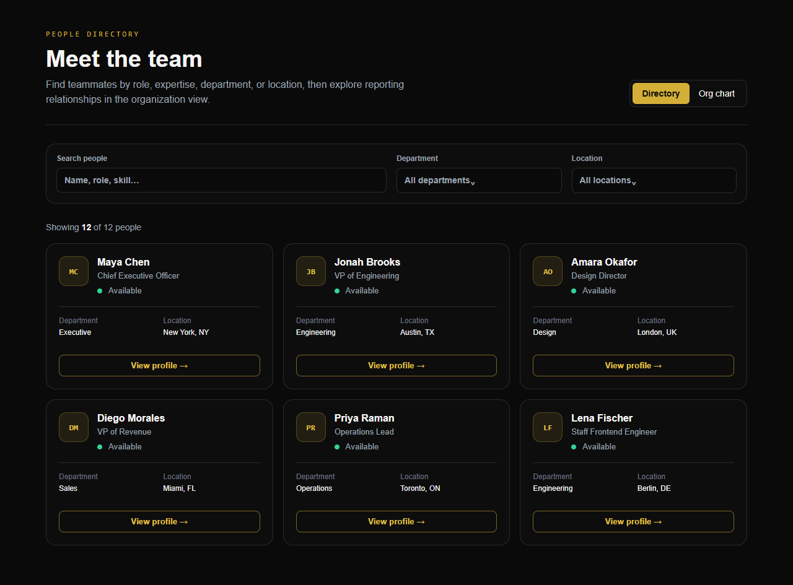
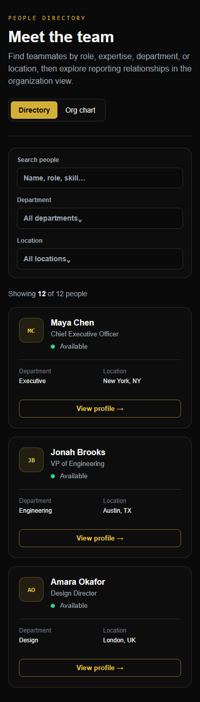

# Employee Directory — Bounty #27

A self-contained React and TypeScript employee directory following the Agent Midas dark/gold design system.

## Preview

## Features

- Search across names, roles, departments, locations, and skills
- Department and location filters with a live result count
- Responsive employee cards and an accessible empty state
- Recursive organization chart built from manager relationships
- Detailed profile dialog with reporting line, availability, expertise, email, and phone actions
- Host-provided employee data plus explicit loading and error states
- Keyboard focus states, labelled controls, status announcements, and 375px-friendly layouts
- Strict exported profile type and no new package dependencies

## Integration

Copy `EmployeeDirectory.tsx` into the host React application and render `<EmployeeDirectory />` from the desired route. Pass `employees`, `loading`, and `error` when connecting an API. The component expects React hooks and the repository's Tailwind CSS pipeline; it adds no dependencies or configuration.

Replace the example `EMPLOYEES` constant with API data when the host employee endpoint is available. Keep the `EmployeeProfile` shape or adapt the response before passing it into the component.

## Verification checklist

- Search by name (`Maya`), skill (`React`), role (`Engineer`), and location (`Austin`)
- Combine department and location filters, then clear them
- Confirm the no-results state and reset action
- Switch between Directory and Org chart views
- Open and close profiles using keyboard controls
- Verify email and telephone links
- Inspect layouts at 375px, 768px, and 1280px
